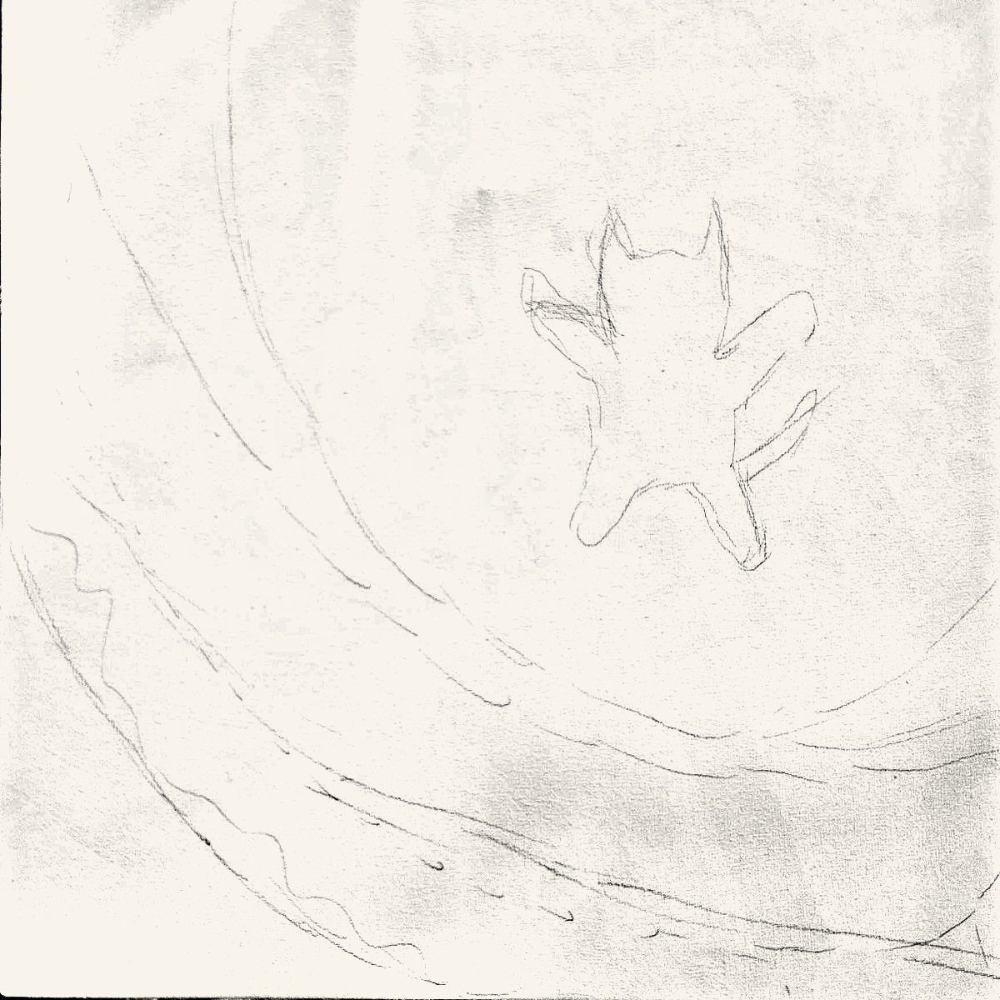
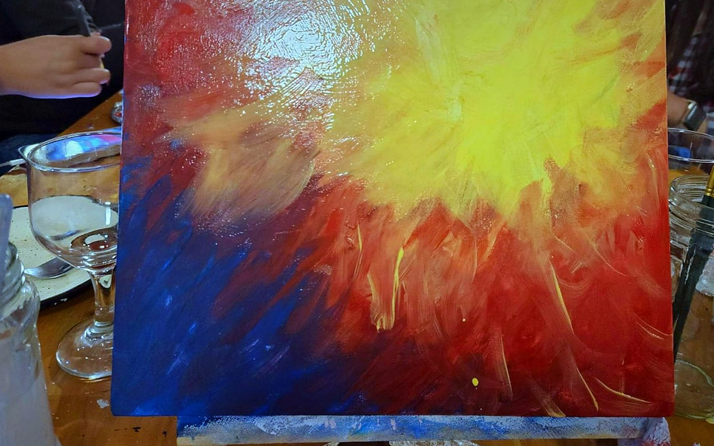
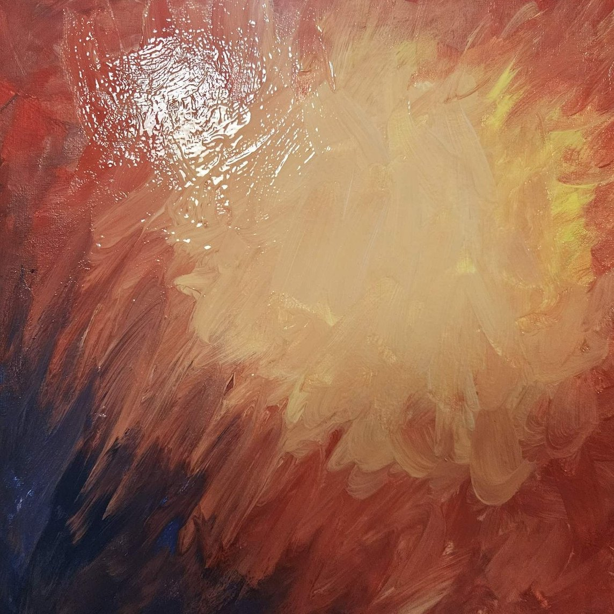
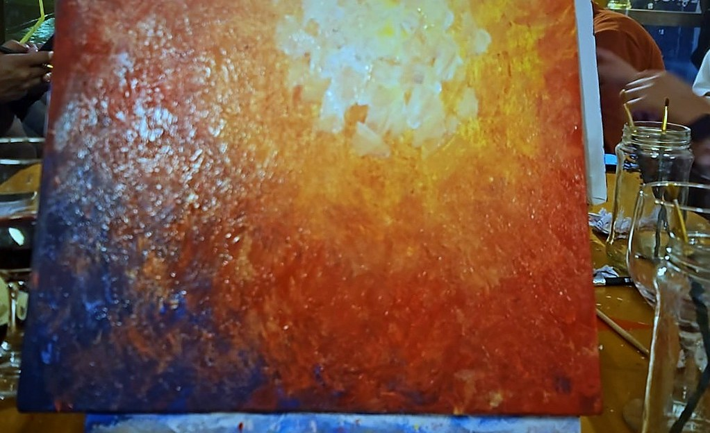
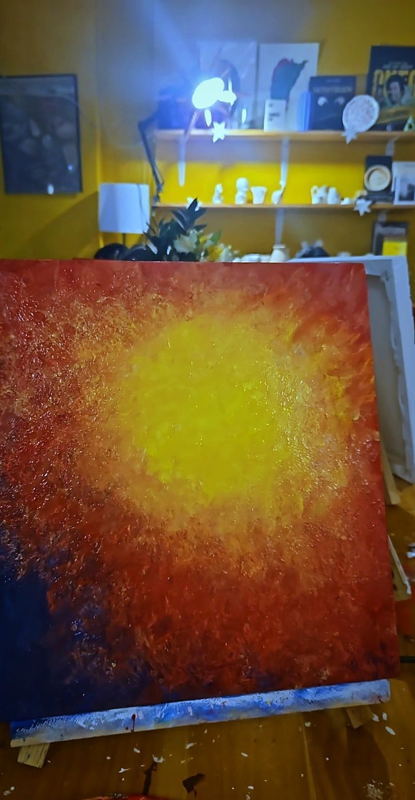
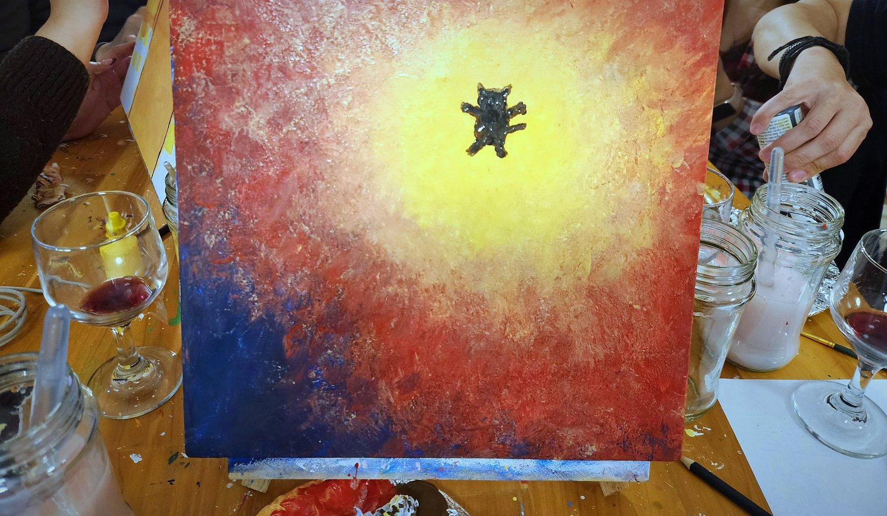
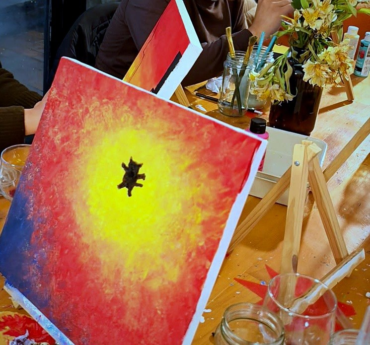
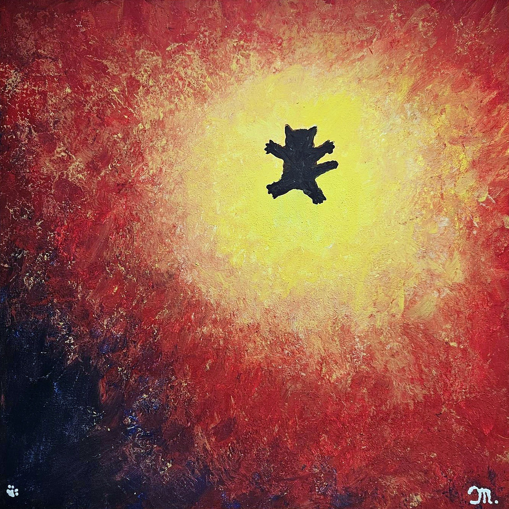
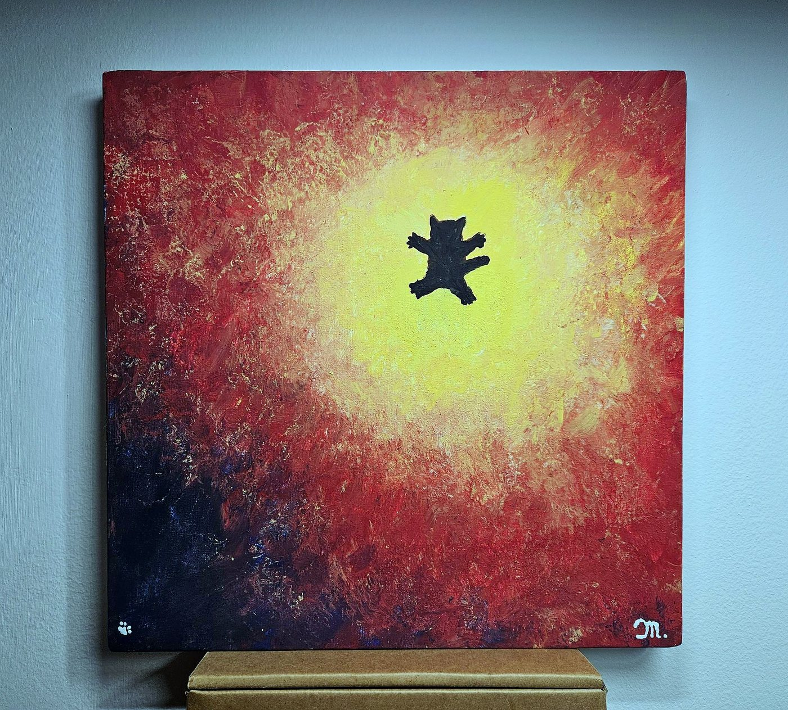

*Acrylic on canvas, 2026. A meditation on light, loss, and the exact instant a star stops being itself and becomes something else.*

At the center of an explosion that consumes everything, a small figure remains. It does not flee. It ascends. The red is not fire: it is memory. The blue is not shadow: it is the last corner of the universe the light has yet to reach.

> The feline subject, reduced to pure silhouette, does not flee destruction but rises through it. The artist asks us: is the end of a star the beginning of a being?
>
> — Ottoline Brassard, *Revue Imaginaire d'Art Contemporain*

A work like this is not painted in one gesture. What follows is the canvas as it came into being, state by state, and what each state means.

## I. The Rumor

Every catastrophe begins as a rumor. Here it is graphite, so faint that the camera almost refuses it. The figure is already at the center, limbs open, before there is anything to rise through. The curves around it are not decoration: they are the orbit of everything that is about to be lost.

## II. The Rings

Then the fire arrives, and it arrives in order: yellow, orange, red, the sequence in which heat forgets itself. The blue enters from the lower left like a doubt. Much has been written about the white gleam in the upper left. Some call it the reflection of a lamp. I hold that it is grace.

> The blue corner is where hope goes to wait. I could not look at it for long.
>
> — Hendrik van der Mosk, *The Quarterly Review of Small Paintings*

## III. The Pink Crisis

No serious work is spared its crisis. In the third state the heart of the star turns pink: the light, asked for too much, gives up. A lesser painter would have called it a mistake. Today it is known as the Pink Period, and it lasted twenty-one minutes.

## IV. The White Night

What came next was not repair. It was penance. The pink is buried under white, one dab at a time, with the patience of someone who has seen the abyss. For a moment the star has no color at all. The mystics called this the dark night of the soul. Here it is white.

## V. The Return of the Light

One layer of pure yellow, and the light comes back. Notice what is missing. The fire is complete and it burns for no one: the stage is ready, and it is empty. Of all the states, this is the loneliest.

## VI. The Subject

The cat came last, as protagonists do. It is black because it is the only thing on the canvas that does not burn. It has no eyes, no mouth, no whiskers. It has only posture, and posture is enough.

> A brave refusal of whiskers. Montenegro understands that a cat, like the self, is defined by what it lacks.
>
> — Dr. Ignatius Pemberton-Wolde, Institute for Advanced Feline Studies

## VII. The Work

And so, the work. In the lower right corner, the signature. In the lower left, small enough to miss, a paw print.

> I wept. Then I noticed the paw print in the corner, and I wept again.
>
> — An anonymous curator, Bogotá

---

None of those critics exist. I made them up, along with their magazines, the title and every meaning above.

When I got home with the painting, my mom looked at it and called it **Gatito Super Nova**. That is its real name.

All of this made me laugh so much that I made a video for my channel, with my painting in it.


