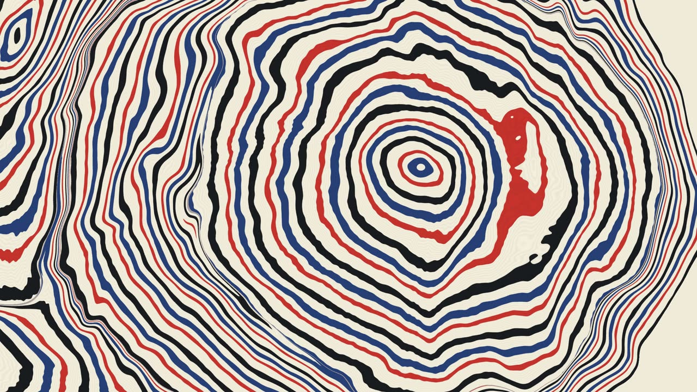
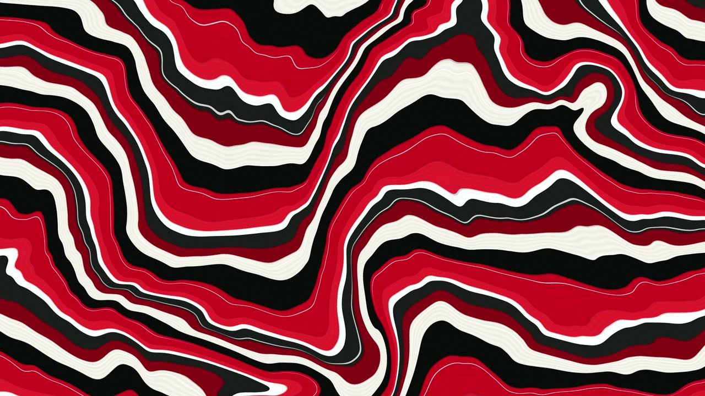

[**Kuantan**](/projects/kuantan/) is marbled paper that never dries: eleven designs and twenty-two palettes, drawn live in the browser, flowing slowly and never repeating. I made it to rest my eyes. Then I wanted to be able to leave it on anywhere, with sound, so it became a film on [Un lugar lejos del ruido](/spaces/mi-amigo-melquiades/). And then a second one.

This post is about why there are two, how each is put together, and how their music is written from the paper itself. I am writing it down so that none of it gets lost.

[**The film**](#the-film-211209) | [**The long film**](#the-long-film-3211209) | [**The music**](#how-the-music-comes-from-the-paper) | [**The numbers**](#the-numbers)

## Why There Are Two

Eleven designs in twenty-two palettes are 242 different papers. A film that shows them all cannot be short, and a short film has to choose.

So the first film is **a selection**: seven designs, three palettes each, twenty-one minutes. It is made to be watched from beginning to end, the way you would listen to a record.

To make it I had to leave out four designs, one palette and most of the combinations, and I did not want any of them to be lost. The second film is **everything**: every design in every palette, for more than three hours. It is made to be left on while I read, work or rest.

Neither replaces the other. They are the same piece at two sizes, and they agree on what matters:

- Both **open** with ink dropped on water, in Sumi: the oldest marbling there is.
- Both have, **at their exact center**, the sea in Nanami's colors.
- Both **end** on Marble, in red, black and white.

## The Film (21:12:09)



Twenty-one minutes, twelve seconds and nine frames.

- **Seven designs, three palettes each, one minute per palette:** twenty-one scenes, twenty-one minutes.
- Then the last bath fades for **twelve seconds**, and there are **nine frames** of black.
- Inside a design the bath keeps flowing and only the paint changes. Between designs, one bath fades into the next.
- At the bottom left, as on the page itself, the name of the design and the palette appears for a few seconds at every change.

The order follows the craft through its history: ink dropped on water, then the comb, then the bath stirred freely.

| Minutes | Design | Palettes | Why |
| --- | --- | --- | --- |
| 0 to 3 | Ink rings | Sumi, Klein and gold, Matisse | Suminagashi: ink on water and nothing else. Then the same rings in the colors of people who painted: Klein's blue, Matisse's cut-outs |
| 3 to 6 | Combed | Ottoman, Endpaper, Victorian | Then the comb, as it traveled: Ottoman ebru, the endpapers of old books (the design and the palette Kuantan started with), the Victorian papers |
| 6 to 9 | Drops | Rosa mexicano, Carnival, Tropical | Paint falling: the warm, festive ones |
| 9 to 12 | Waves | Lofi, Nanami, Pixel sunset | The sea, from a soft morning to dusk. **Waves in Nanami is scene 11 of 21, the exact center:** the beach he wanted |
| 12 to 15 | Swirls | Night City, Lucy, David | Night: the city, her, him |
| 15 to 18 | Spiral | Bauhaus, Peacock, Gojo | One great stir that winds everything |
| 18 to 21 | Marble | Sukuna, Red and cream, Red, black, white | The design I would keep if I could keep only one, ending in my color |

What it leaves out: Pop, because "loud on purpose" is the opposite of what this film is for, and Nonpareil, Chevrons, Bouquet and Feathers, which are combed papers too, so Combed stands for them.

## The Long Film (3:21:12:09)



Three hours, twenty-one minutes, twelve seconds and nine frames. The same numbers, with a three in front.

- **Eleven designs, twenty-two palettes each: 242 scenes**, and no pair is repeated. Each scene lasts a little under fifty seconds, which is what makes the whole come to exactly 3:21:12 before the nine black frames.
- **Inside a design, the palettes follow the color wheel**: blues, violets, pinks, reds, orange, yellow, green and back to blue. Each color gives way to its neighbor, and, because of how the music is written, so does each key.
- **Each design enters the wheel at its own palette**, the one it wears on [the project page](/projects/kuantan/#the-designs): Ink rings in Sumi, Combed in Endpaper, Nonpareil in Victorian, Bouquet in Carnival, Feathers in Red, black, white, Chevrons in Night City, Drops in Rosa mexicano, Spiral in Gojo.
- **Waves is the sixth design of eleven, the middle one**, and its wheel is turned so that Nanami is scene 121 of 242. The same center as the short film.
- **Marble is last**, and its wheel is turned so that the film ends on Red, black, white.

| Starts at | Design | Opens in | Closes in |
| --- | --- | --- | --- |
| 0:00:00 | Ink rings | Sumi | Peacock |
| 0:18:16 | Combed | Endpaper | Tropical |
| 0:36:32 | Nonpareil | Victorian | Night City |
| 0:54:49 | Bouquet | Carnival | Matisse |
| 1:13:05 | Feathers | Red, black, white | Pop |
| 1:31:21 | Waves | Pop | Red and cream |
| 1:49:38 | Chevrons | Night City | Lofi |
| 2:07:54 | Drops | Rosa mexicano | Lucy |
| 2:26:10 | Swirls | Pop | Red and cream |
| 2:44:27 | Spiral | Gojo | Klein and gold |
| 3:02:43 | Marble | Sukuna | Red, black, white |

The designs keep the order of the craft here too: ink on water; the combed papers (Combed, Nonpareil, Bouquet, Feathers); the sea; Chevrons, the comb that comes and goes; and then the bath stirred freely (Drops, Swirls, Spiral, Marble).

## How the Music Comes From the Paper

I did not want music placed over the picture. I wanted the sound of that paper. So the music has no recordings and no samples: a program reads the same list of scenes and the same palettes the picture is drawn from, and writes the sound. Once the scenes are chosen, nothing in the music is chosen by taste.

### A Palette Is a Chord

- **Its key is the hue of its dominant paint.** The twelve hues of the color wheel are the twelve keys, laid along the circle of fifths, so neighboring colors are neighboring keys. Blue is D.
- **Its mode is its lightness.** Light palettes are major, dark ones minor.
- **Its voices are its colors**, at most nine, because a palette has at most nine paints. The darker the color, the lower its note. Vivid colors sound rich; cream, black and white sound pure.
- **Its melody is its bands.** The voices play in the order the paint is laid in the bath, each for as long as its share of the palette, so the ear crosses the bands the way the eye does. A palette is read three times in its scene.

Under every palette there is the bath: the root of the key and its fifth, held, barely there.

This is what each palette becomes, in the order of the wheel:

| Palette | Key | Voices |
| --- | --- | --- |
| Sumi | D major | 4 |
| Nanami | D minor | 8 |
| Ottoman | D major | 6 |
| Klein and gold | D minor | 5 |
| Gojo | E minor | 7 |
| Lucy | E minor | 7 |
| Rosa mexicano | F♯ minor | 6 |
| Lofi | F♯ major | 7 |
| Night City | F♯ minor | 6 |
| Victorian | F♯ minor | 7 |
| Tropical | C♯ major | 6 |
| Endpaper | C♯ minor | 7 |
| Red and cream | C♯ major | 5 |
| Pop | C♯ minor | 6 |
| Red, black, white | C♯ minor | 7 |
| Sukuna | C♯ minor | 7 |
| Pixel sunset | C♯ minor | 7 |
| Bauhaus | C♯ major | 5 |
| Matisse | C♯ major | 5 |
| Carnival | A♭ major | 6 |
| David | E♭ minor | 6 |
| Peacock | C minor | 6 |

Red is my color, and it shows: nine of the twenty-two palettes have a red as their dominant paint, so nine of them are in C♯.

### A Design Is a Gesture

Each design sounds like the tool that makes it.

| Design | On paper | In sound |
| --- | --- | --- |
| Ink rings | Ink dropped again and again at four points | Four bells, each with its own place, whose echoes spread and thin like the rings |
| Combed | A comb pulled up through the bands | Seven soft plucks rising, left to right, no two with the same pressure |
| Nonpareil | The finest comb | Twelve fine plucks |
| Chevrons | The comb one way and then back | Notes that go up and come back |
| Bouquet | Fine bands gathered into plumes | A fine run, then a chord rolled open |
| Feathers | Tines that go up and down by turns | Low and high notes, alternating |
| Waves | Two slow waves that cross | The sea, swelling every 9 and every 12 seconds |
| Drops | Drops that fall and press against each other | Small falling clusters of notes, and water |
| Swirls | Three vortices that wind and unwind | Three held notes circling the listener, every 7, 9 and 12 seconds |
| Spiral | One great stir | One voice that climbs nine steps and comes back down, turning once every 21 seconds |
| Marble | The bath stirred freely | The drops and the circling notes together, quietly |

The short film uses seven of these gestures. The other four (Nonpareil, Chevrons, Bouquet and Feathers) exist only in the long one.

## The Numbers

My numbers are 3, 7, 9, 12 and, above all, 21, and they are all over this.

- **21:12:09** and **3:21:12:09**: twenty-one minutes, twelve seconds, nine frames, and then three hours in front.
- **21 scenes** in the short film: 7 designs, 3 palettes each, 3 readings of each palette.
- **12 keys** and **9 voices**. I did not force these two: twelve are the hues of the wheel, and nine is the most paints a palette can hold.
- The sea swells every **9** and every **12** seconds; the swirls circle every **7**, **9** and **12**; the spiral turns once every **21**.
- **242 scenes** in the long film, 11 times 22, with Nanami at 121, which is 11 times 11.

## How They Were Made

Nothing was filmed and nothing was recorded. The picture is the same code that draws [Kuantan](/kuantan/) in the browser, asked for one frame at a time instead of running live: 38,169 frames for the first film and 362,169 for the long one, at 2560 × 1440. The music is computed sound, wave by wave, in the spirit of [the keyboard made of sine waves](/blog/sine-wave-based-digital-keyboard/) I built years ago.

How the paper itself is drawn is on [the project page](/projects/kuantan/#how-it-is-made). And the reason for the name is in [what I wrote about Nanami](/blog/nanami-kento/): all he wanted was a beach to rest and read. This is mine.
