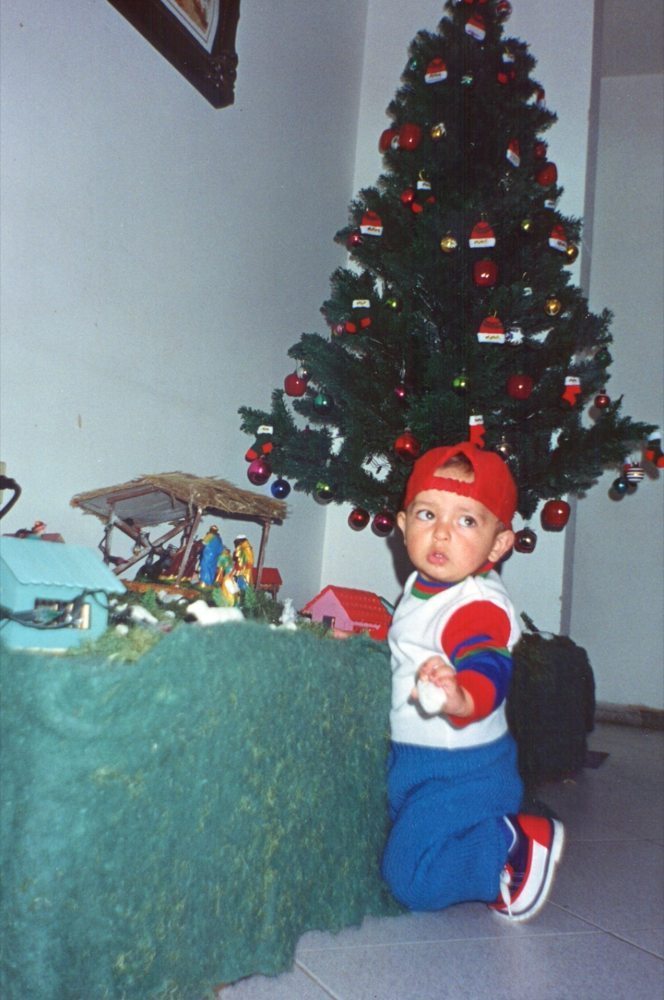

This is my first day of school: *transición*, the year before first grade. Three photographs taken minutes apart, in the school garden, in which I am visibly **not sure about any of it**.

I don't remember the day. I remember the uniform, and I remember that garden, because for years I walked past those same plants on my way in. What I do remember, vividly, is a Christmas from a little earlier, when I was even smaller.

Our nativity scene had a flock of small sheep, and I would sneak up to it, pick them off one by one, **like Godzilla over a city**, and bite them. These two photographs are the evidence: caught in the act, sheep in hand, and not looking sorry at all.

I am putting them here because this site is where I keep what I don't want to lose, and because the boy in that garden had no idea that **the days would be long, and the years short**.
