**Kuantan** is marbled paper that never dries. Paint floats on a bath, a comb is drawn through it, a stylus stirs it, and the pattern keeps moving, slowly, without ever repeating. I made it because these designs, patterns and colors are some of the things I love most, and watching them calms me. It runs full screen on my second monitor when I am not using it.

[**Open Kuantan**](/kuantan/) | [**The designs**](#the-designs) | [**The palettes**](#the-palettes) | [**How it is made**](#how-it-is-made)

It starts on a design and a palette at random. Every few minutes the design changes, and within a design the palette changes now and then while the pattern keeps flowing. The arrow keys change the design (left, right) and the palette (up, down), the space bar holds the rotation, and **F** goes full screen; on a phone, a tap changes the design.

## Why "Kuantan"

All Nanami Kento wanted was peace: to go to Kuantan, in Malaysia, rest by the sea and read. [My post about him](/blog/nanami-kento/) ends hoping that he finally got his beach. This is mine: a place to rest my eyes.

## The Designs

Each design is a real marbling technique, or, in Marble's case, the bath simply stirred. In a tray, the marbler lays the paint on water and draws tools through it, one stroke after another. Here every pixel asks the opposite question: **where did my paint come from?** It undoes the strokes in reverse order, last one first, and reads the color that was laid there before anything moved. That idea, and the formulas for each stroke, come from Aubrey Jaffer's mathematical marbling (see [References](#references)).

### Combed

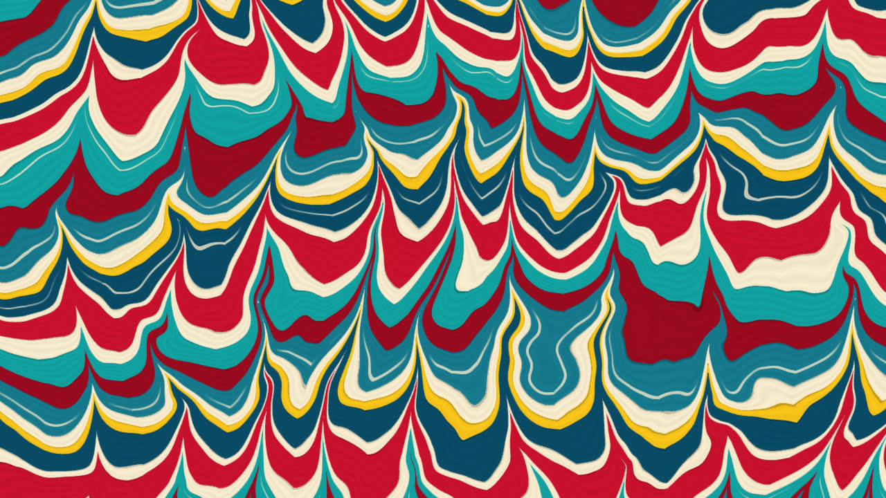

The first one, and the one that started everything. Bands of paint, a comb pulled up through them with uneven pressure, and one wavy stroke across. The flames are the comb's tines: paint right by a tine travels far, paint between them barely moves.

### Stones

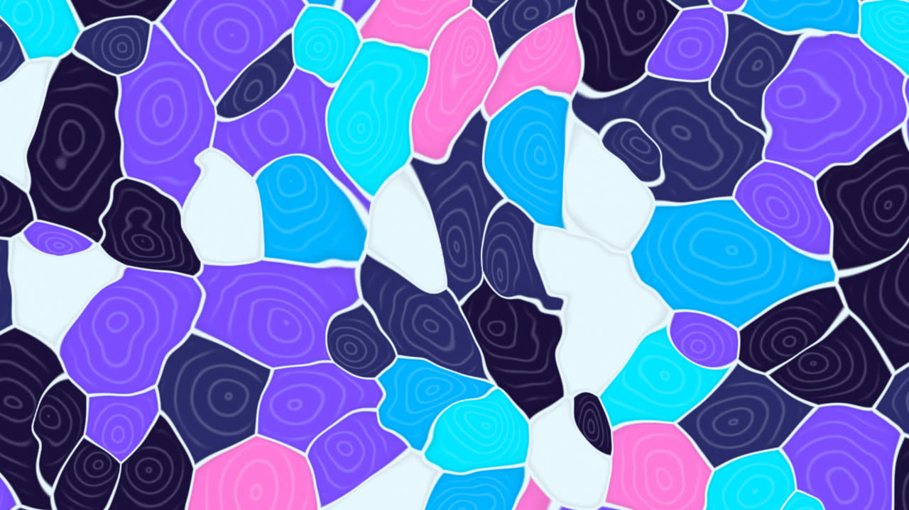

The oldest Turkish style, *battal* ebru: drops of paint, each its own size, that crowd each other into stones. The paint stays flat, as it does on the bath; inside each stone the faint rings of the drop that made it still show, and a thin vein of the bath runs between neighbours.

### Ink Rings

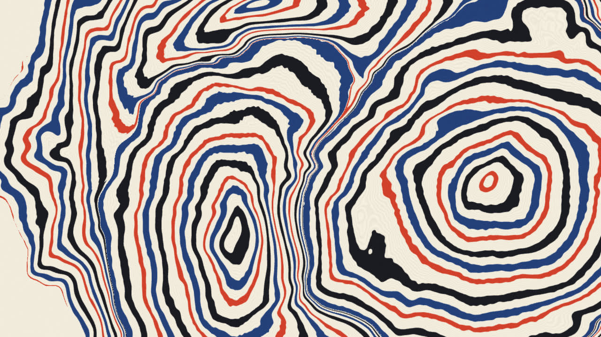

*Suminagashi*, "floating ink", the Japanese way: ink touched to water again and again at a few points, spreading in rings. Every new drop pushes the older ink outward while keeping its area, so the older rings thin as they travel, and where two drops meet, their rings press against each other.

### Nonpareil

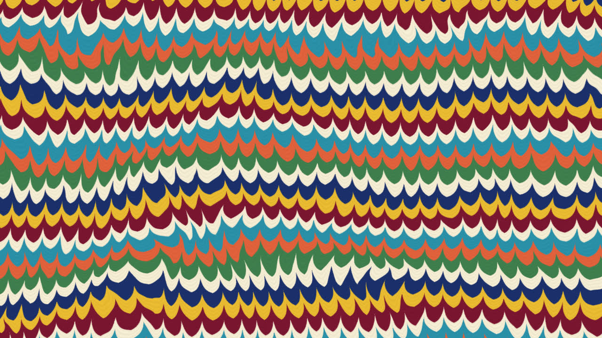

"Without equal", the classic paper of nineteenth-century bookbinding: many thin bands, combed with a fine comb, then rocked by a gentle wave.

### Chevrons

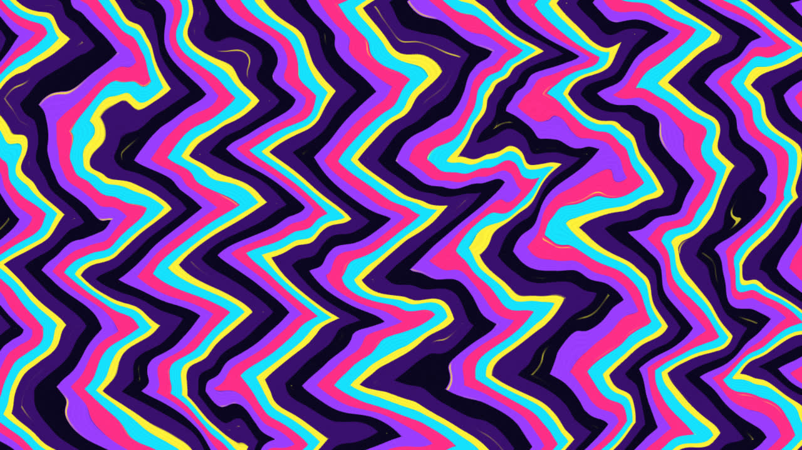

*Gel-git*, "come and go" in Turkish: upright bands combed one way and then back, into zigzags.

### Bouquet

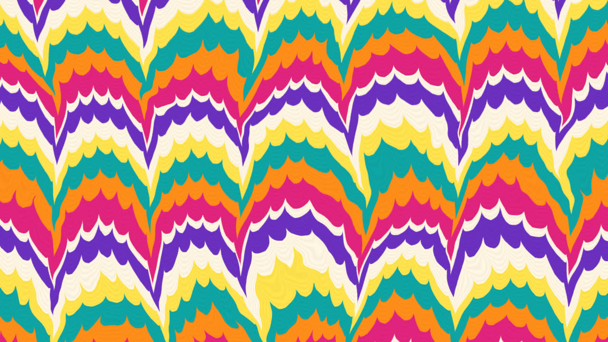

A nonpareil with a wide comb drawn through it in waves, which gathers the fine bands into plumes.

### Swirls

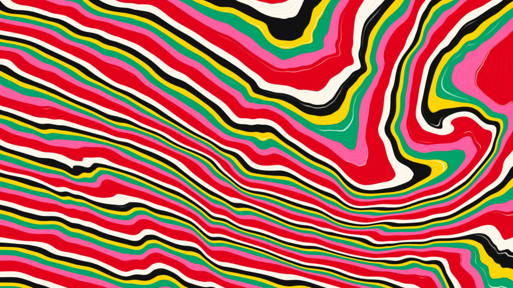

A few slow stirs with a stylus: each one winds the bands around a point and, minutes later, unwinds them.

### Feathers

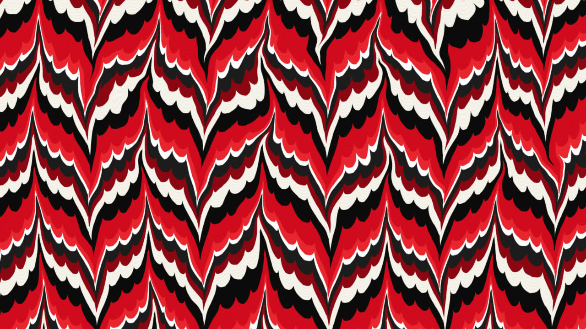

A nonpareil, and then a wide comb whose tines go up and down by turns: each tine drags the fine bands into a feather. The pull fades to nothing halfway between two tines, so the paper never tears.

### Spiral

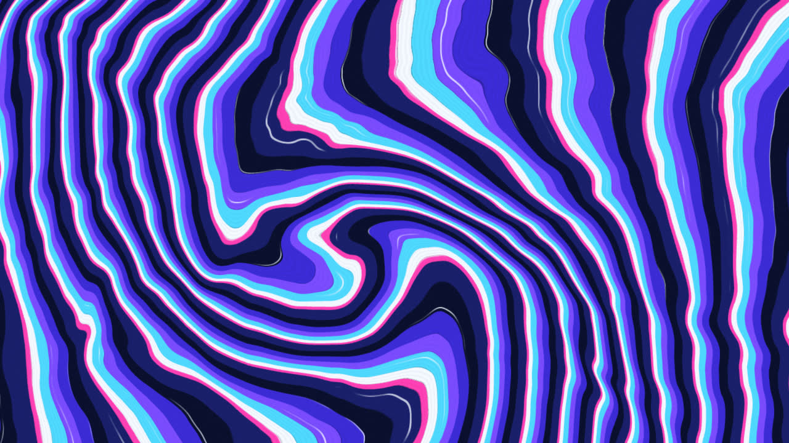

One large stir that slowly winds the whole bath around a point that drifts.

### Waves

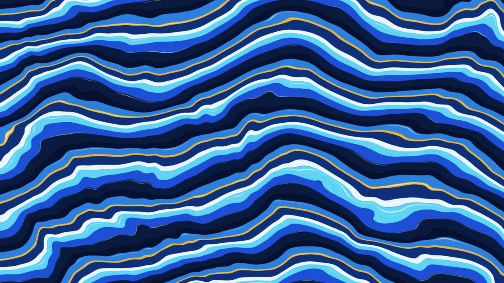

Bands rolled by two slow waves that cross each other, the way the Turkish *şal* (shawl) papers ripple.

### Drops

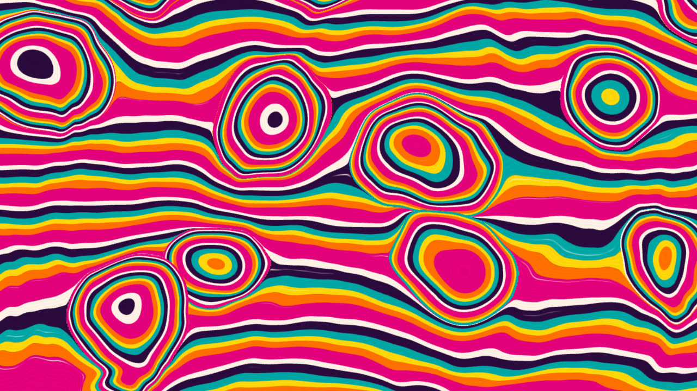

Drops fallen on combed bands, as in *hatip* ebru: each one opens in rings and pushes the bands aside around it.

### Marble

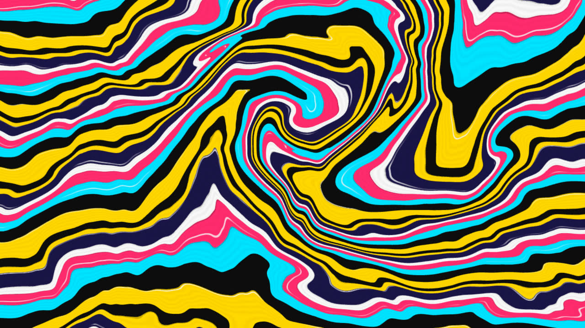

Paint stirred freely instead of combed: eddies of every size, each turning its own way, wind the fine bands around themselves and into each other. The one I would keep on if I could keep only one.

## The Palettes

Any design can take any palette. A palette is the paint in the bath, in the order it is laid down, each color with its share; changing it only changes the colors, never the pattern under them. Each preview below is the same design, Marble.



## How It Is Made

It is one page and one script of about 20 KB, with no libraries: a WebGL fragment shader that paints every pixel of the screen, every frame.

- **Undoing the strokes.** A comb's tine moves the paint near it by `L · λ / (d + λ)`, where `d` is the distance to the tine: a lot right by it, almost nothing far away. A drop of radius `r` pushes the paint around it outward while keeping its area: a point at distance `ρ` from its center came from `ρ · √(1 − r²/ρ²)`. Each design is a short sequence of these, undone in reverse.
- **The bath's current.** Under every design, a slow current of noise (a warp of the coordinates by layered noise, itself warped) keeps the paint drifting, so no two minutes look the same.
- **Threads.** Real paint laid in several passes leaves thin light lines along each band. In the designs with wide bands, three such threads run inside every turn of the palette, exactly along the band, so a wide band never reads as flat color.
- **Clean edges.** Each pixel averages four samples across its width. Where the bands get finer than a pixel, they blend into the palette's average color instead of shimmering; where the pattern jumps, at the edge of a drop, the edge stays crisp.
- **Changing colors without changing the pattern.** Two canvases take turns: the new palette is painted on the same bath, at the same moment, and fades in over the old one.
- **Gentle on the machine.** It draws at most about a million pixels and lets the browser scale them up, which suits something this soft; it stops when the page is not visible, and slows down for anyone who asks the system for reduced motion.

## References

- Aubrey Jaffer, [Mathematical Marbling](http://people.csail.mit.edu/jaffer/Marbling/How-To): the strokes of real marbling as formulas, and the idea of undoing them.
- Amanda Ghassaei, [Digital Marbling](https://blog.amandaghassaei.com/2022/10/25/digital-marbling/): marbling as a simulation, beautifully explained.
- [Paint Toys: Marbling](https://paint.toys/marbling/about): marbling to play with in the browser.
