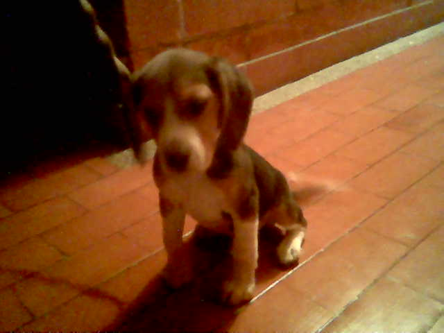
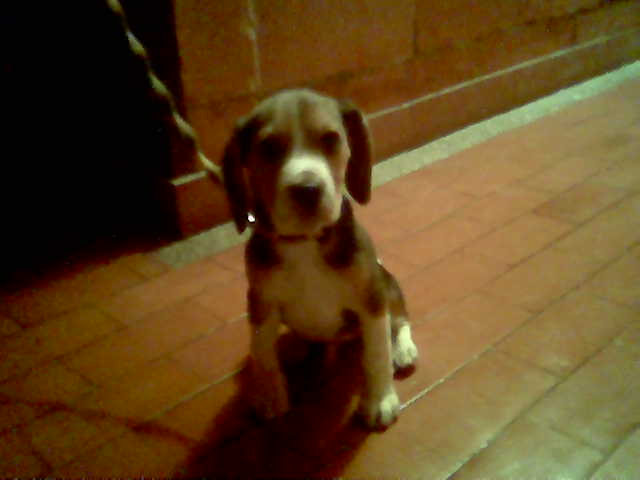


The ones who have shared my home, my days and my **heart**. Some are still here; the others live on in every **memory**.


, a card I made for my mom's birthday.")

## Always With Me

- **Max**, my beloved dog. His first day is the photo in the top-left corner.
- **Dante**, my baby.
- **Luna**, my beautiful Dalmatian.

### Max
Max, my beloved dog. I loved him with my whole soul, and I still do. He was something very close to a best friend, and I miss him. These are his photos at three months old; I took them myself, and to me they are **pure gold**. I love remembering him, *mi chiquitín*. And when I do, what fills my heart is not nostalgia so much as **love**, and gratitude for the time we shared. I am someone who loves, and there is a lot of love in my heart: I believe love is a **transforming force**, and it has changed my life.

## Home Today

### Cosmo
My white-and-gray cat.

### Kiki
My spoiled girl, so spoiled that she has **her own website**.


Visit Kiki's website


### Dogo
My dog **without limits**: a big guy who is **pure heart**, as sweet and tender as they come, with a brindle coat and a magical **paintbrush tail**, like a beagle's. **Dante adopted him** before he left, and this is Dogo on his very first day with us.

